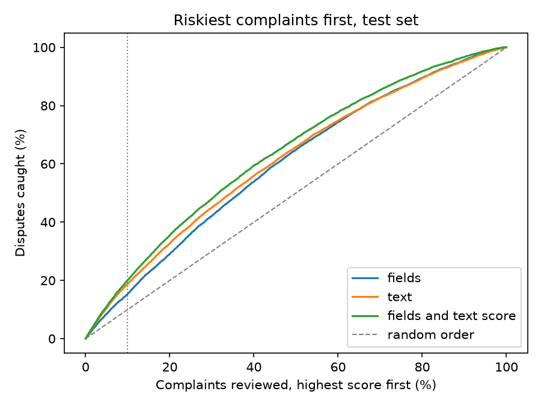

# Complaint text classification

Does the text of a complaint say whether the consumer will dispute the company's response, and does it add anything to a model built on the complaint's other fields?

The answer to both is yes. A TF-IDF and logistic regression model on the complaint narrative gets a test ROC-AUC of 0.642, against 0.626 for the fields on the same complaints and 0.671 for the two together. In the 10% of complaints with the highest scores, 41.8% are disputed with both against 32.1% with the fields alone. The [executive summary](reports/executive_summary.md) has the one-page version.

The project follows PACE (Plan, Analyze, Construct, Execute). Decisions and findings are written up as they happened in [notes.md](notes.md).

## Plan

This is a follow-up to the [complaint-escalation project](https://github.com/Karim0004/complaint-escalation), which ranks complaints by dispute risk from their fields (product, company, channel, the company's response) and left the text out. The team is the same: people who review a company's responses and want the riskiest ones first. The question here is whether a model that reads the consumer's narrative gives them a better list.

Like the first model, it scores a complaint when the company responds. The narrative is written when the complaint is filed, so it's known by then.

### Data

The data is the same file as the first project, from the [CFPB Consumer Complaint Database](https://www.consumerfinance.gov/data-research/consumer-complaints/). CFPB stopped recording whether the consumer disputed the response on 24 Apr 2017 and has since removed that column from its public download. This project uses the CFPB file dated 7 Dec 2025, as archived by the Internet Archive on 9 Dec 2025 ([complaints.csv.zip](https://web.archive.org/web/20251209002532/https://files.consumerfinance.gov/ccdb/complaints.csv.zip)).

Of the 432,952 complaints received from 1 Jan 2015 to 24 Apr 2017, 164,437 have a narrative (38%). CFPB publishes a narrative only when the consumer agrees to it, with personal details replaced by XXXX. The first one is from 19 Mar 2015 and all of them are web complaints. After cleaning there are 149,661 narratives from 19 Mar 2015 to 28 Feb 2017, and 22.6% of them were disputed.

### Leakage

The fields follow the first project's list. Anything that could be known only after a dispute stays out, so the company's public response is out, and the response type and the timely flag stay.

The text brings two leaks that the fields don't have. The first is template letters: 7,236 of the 112,256 training narratives start with the same 100 characters as another one, and with plain cross-validation folds the copies of a letter land on both sides. Narratives that share an opening are kept in the same fold, which lowers the baseline's score by 0.005 ROC-AUC. 286 test narratives share an opening with a training one, and the test scores are also given without them.

The second is the text model's score when it's used as a feature next to the fields. The training rows get out-of-fold scores, so a complaint's own label never goes into its score. The vocabulary and the TF-IDF weights are fitted inside each training fold as well.

### Ethics

CFPB publishes the narratives with the consumer's consent and with personal details redacted. State isn't a feature.

A model that reads the text can only score complaints that have one. In the test months that's 42.8% of complaints, and the rest only have the fields. The review list also leans towards long narratives: 20.2% of the longest quarter are in the top 10% and 3.7% of the shortest quarter. That follows their dispute rates (26.8% and 15.9%), but it means a consumer who writes little is reviewed less often.

The data tags complaints from older Americans and servicemembers. Older Americans are on the list about as often as untagged consumers (9.5% against 10.1%). Servicemembers are on it less often (8.6%), although they disputed at the same rate in the test months. They disputed less often in the training months, and the models learned that. Anyone using the scores should repeat both checks on new data.

## Analyze

| Notebook | What it covers |
| --- | --- |
| [01_initial_exploration](notebooks/01_initial_exploration.ipynb) | Which complaints have a narrative, how long they are, redaction marks and repeated texts |
| [02_cleaning](notebooks/02_cleaning.ipynb) | `load_text()`, the redaction tokens, short narratives and template letters |
| [03_eda](notebooks/03_eda.ipynb) | Length, common words and phrases, dispute rate by word, template letters |

CFPB's redaction marks would otherwise be the most common word, so `clean_text()` turns them into three tokens: `xxmoney` for amounts, `xxdate` for dates and `xxxx` for everything else. Short narratives and repeated texts stay in, since a model in use would get them too. The data stops at 28 Feb 2017, the first project's cut-off, because complaints from the last weeks never had time to be disputed.

Longer narratives are disputed more often, from 15.4% for 25 words or fewer to 30.6% for more than 400. Legal and formal wording has the highest dispute rates (evidence 36.5%, cfpb 34.8%, certified mail 33.5%), and wording about phone calls and everyday banking has the lowest. Company names carry the company's own rate: narratives that mention Equifax are disputed 33.4% of the time and ones that mention Experian 18.3%. Template letters sent in bulk are rarely disputed, 13.3% for openings used 10 times or more.

## Construct

| Notebook | What it covers |
| --- | --- |
| [04_split](notebooks/04_split.ipynb) | Train up to 30 Sep 2016, test from 1 Oct 2016 to 28 Feb 2017 |
| [05_baselines](notebooks/05_baselines.ipynb) | Majority class, length only, TF-IDF with logistic regression |
| [06_models](notebooks/06_models.ipynb) | TF-IDF settings, then logistic regression against Naive Bayes and a linear SVM |
| [07_explain](notebooks/07_explain.ipynb) | The words and phrases with the largest weights |
| [08_text_against_fields](notebooks/08_text_against_fields.ipynb) | The fields, the text and both on the same complaints, then one test run |

The split is the first project's, so both projects are tested on the same five months. That gives 112,256 narratives for training (23.2% disputed) and 37,405 for testing (20.8%).

The chosen text model is TF-IDF on words and two-word phrases with the stop words left in, then logistic regression with C 0.3 and balanced class weights. To compare it with the fields, the first project's `build_features()` is run on the same complaints, without channel and consent, which are the same for every narrative. The combined model is a logistic regression on those fields and one more column, the text model's out-of-fold score.

### Results

The text models, scored with 5-fold cross-validation on the training set:

| Model | CV ROC-AUC | CV average precision |
| --- | ---: | ---: |
| Majority class | 0.500 | 0.232 |
| Length only | 0.567 | 0.276 |
| TF-IDF on words + logistic regression (baseline) | 0.629 | 0.343 |
| TF-IDF on words and two-word phrases + logistic regression (C 0.3), chosen | 0.650 | 0.364 |

The fields, the text and both, on the same complaints. The form of each model was picked on cross-validation, and then the three were scored once on the test set. The test window has a lower dispute rate, so average precision is lower there for every model.

| Model | CV ROC-AUC | CV average precision | Test ROC-AUC | Test average precision |
| --- | ---: | ---: | ---: | ---: |
| Fields (logistic regression) | 0.626 | 0.321 | 0.626 | 0.289 |
| Text (the chosen model above) | 0.650 | 0.364 | 0.642 | 0.319 |
| Fields and the text model's score (logistic regression) | 0.676 | 0.386 | 0.671 | 0.344 |

Adding the text score to the fields is worth 0.045 ROC-AUC on test, with a 95% interval of 0.040 to 0.051 from resampling the test set. Without the 286 test narratives that share an opening with a training one, the three scores move by about 0.001. The combined model is the best of the three in all seven products with at least 2,000 test narratives, and the text helps most where the fields are weakest: mortgages go from 0.562 to 0.634 and student loans from 0.592 to 0.646.

Before the project started I scored a quick TF-IDF model on the same test months, to see whether the text was worth a project (0.645). Every setting after that was picked on cross-validation.

### What the text model reads

Legal wording (illegal, violated, tcpa, fcra), `attached` and some company names push a complaint towards a dispute. Payday loans, fees and phone calls push away from one. Stop words carry weight too: `they` and `by` push towards a dispute and `my` and `had` away, which I read as narratives about what the company did scoring higher than ones that tell the consumer's own story. The single words aren't steady between two halves of the training set, but these groups are.

Part of what the text knows is the company. The company columns are worth 0.020 ROC-AUC to the fields alone and 0.003 once the text score is in, so about a quarter of the text's gain is the company. What the text can't replace is the company's response, which keeps the largest weights in the combined model. The consumer writes the narrative before the company answers.

## Execute

[09_decision](notebooks/09_decision.ipynb) turns the scores into a review list. A team that can review a tenth of its complaints takes the 10% with the highest scores, 3,740 of the test complaints:

| Model | Disputes on the list | Disputed among reviewed | Times random |
| --- | ---: | ---: | ---: |
| Fields | 1,199 | 32.1% | 1.54 |
| Text | 1,468 | 39.3% | 1.88 |
| Fields and text score | 1,564 | 41.8% | 2.01 |

The text adds 365 disputes to the list, about 98 for every 1,000 complaints reviewed (95% interval 81 to 115). It also changes which complaints are on it, since the fields list and the combined list share only 1,436 complaints.



Ranked across all companies, the list is uneven: 24.2% of the narratives about Equifax are on it and 2.2% of those about Navient. A company's own team would rank inside its own complaints. Done that way for the 55 companies with at least 100 test narratives, the top 10% is 28.6% disputed with the fields and 40.0% with both.

The models use balanced class weights, so the raw scores sit near 0.5 and can't be read as probabilities. A logistic regression with one input, fitted on the training scores, brings them back to the actual rate. On test they then run 1.7 points high (22.5% predicted, 20.8% actual) because the dispute rate fell.

### What didn't work

Naive Bayes was behind logistic regression at every setting, 0.628 at best against 0.650. Dropping English stop words cost about 0.005 ROC-AUC, since the list includes "not". The minimum document frequency barely mattered. A linear SVM was level with logistic regression but has no probabilities. XGBoost at the first project's settings didn't beat logistic regression on the fields (0.628 against 0.626) or with the text score added (0.673 against 0.676). The single words with the largest weights aren't stable either: with the model fitted on two halves of the training set, only 6 of the 20 largest weights towards a dispute were in both lists.

### Limitations and monitoring

The labels end in April 2017, so this shows the method on old data. Only complaints with a published narrative can be scored, and those consumers dispute more often than the rest (20.8% against 14.2% in the test months), so the result may not carry over to the others. A dispute is what the consumer did after the response. It doesn't say the company handled the complaint badly, and nothing here shows that reviewing a complaint prevents the dispute.

Two of the text model's largest weights came from one-off events in late 2015, Scottrade and RushCard, and they account for about a third of its drop from cross-validation to test. A live version would need retraining every few months, the rescaling refitted on recent months, and the checks on servicemembers and short narratives repeated.

## How to run

1. Python 3.11. Install the packages with `pip install -r requirements.txt`.
2. Download `complaints.csv.zip` from the archive link above, unzip it and put the CSV in `data/`.
3. Build the parquet file the code reads:

   ```python
   from src.data import build_parquet
   build_parquet("data/complaints.csv")
   ```

4. Run the notebooks in `notebooks/` in order, from 01 to 09. Notebook 06 takes about 21 minutes, 07 about 6 and 08 about 8. Notebook 09 reads the scores that 08 saves in `data/`. Figures are saved to `reports/figures/`.
