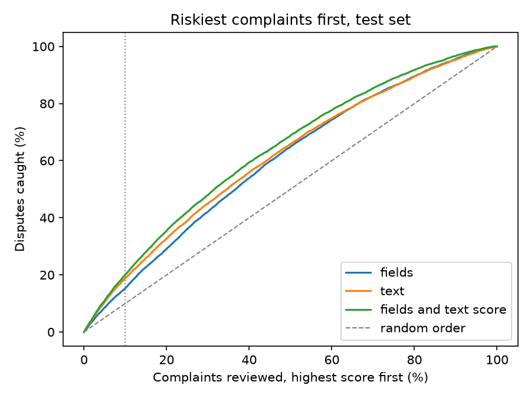

# Complaint text classification: executive summary

## Overview

When a consumer complains about a financial company through the CFPB, they can describe what happened in their own words, and some of them later dispute the company's response. An earlier project ranked complaints by dispute risk from their fields: the product, the company, the channel and the type of response. This one asks whether the consumer's text says anything more. It uses the 149,661 complaints with a published narrative received between Mar 2015 and Feb 2017. CFPB stopped recording disputes in April 2017, so this shows the approach on historical data that a team would then apply to its own complaints.

## Problem

About one narrative in five ends in a dispute (23.2% in the training period, 20.8% in the test period). On these complaints the fields alone rank with a ROC-AUC of 0.626, and a team that reviews the top 10% of that list finds a dispute in 32.1% of the complaints it opens. The text was the one part of the complaint the first model didn't read.

## Solution

A TF-IDF model on words and two-word phrases with a logistic regression, trained on narratives up to Sep 2016 and tested once on Oct 2016 to Feb 2017, the same months as the first project. Its score is then added to the fields as one more column, and the fields, the text and both are compared on the same complaints.

## Key findings

- On the test period the text alone ranks complaints better than the fields, with a ROC-AUC of 0.642 against 0.626, and the two together reach 0.671.
- In the top 10% of the list, 41.8% of complaints are disputed with both against 32.1% with the fields. That's about 98 more disputes for every 1,000 complaints reviewed, and twice what a random 10% would hold.
- Legal wording, attached documents and long narratives point towards a dispute, and wording about phone calls and fees points away. About a quarter of what the text adds is which company the complaint is about.
- The text can't see the company's response, which keeps the largest weights in the combined model, so the fields are still needed.

## Next steps

- Rank inside each company. Across companies the list is uneven (24.2% of the narratives about Equifax are on it and 2.2% of those about Navient), and inside a company the text adds a little more.
- Decide what happens to complaints without a narrative, 57.2% of the total in the test months. They only have the fields.
- Retrain every few months and refit the scores to the current dispute rate, which fell from 23.2% to 20.8%. Repeat the checks on servicemembers and on short narratives, which are both on the list less often.
